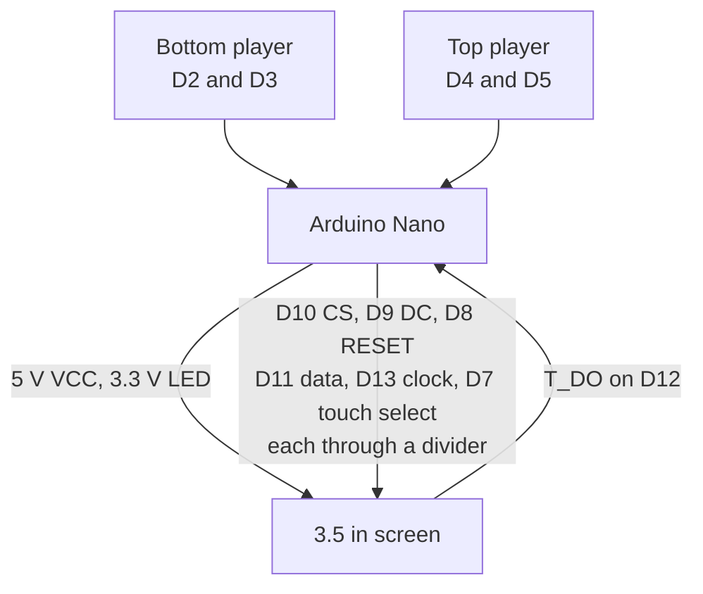
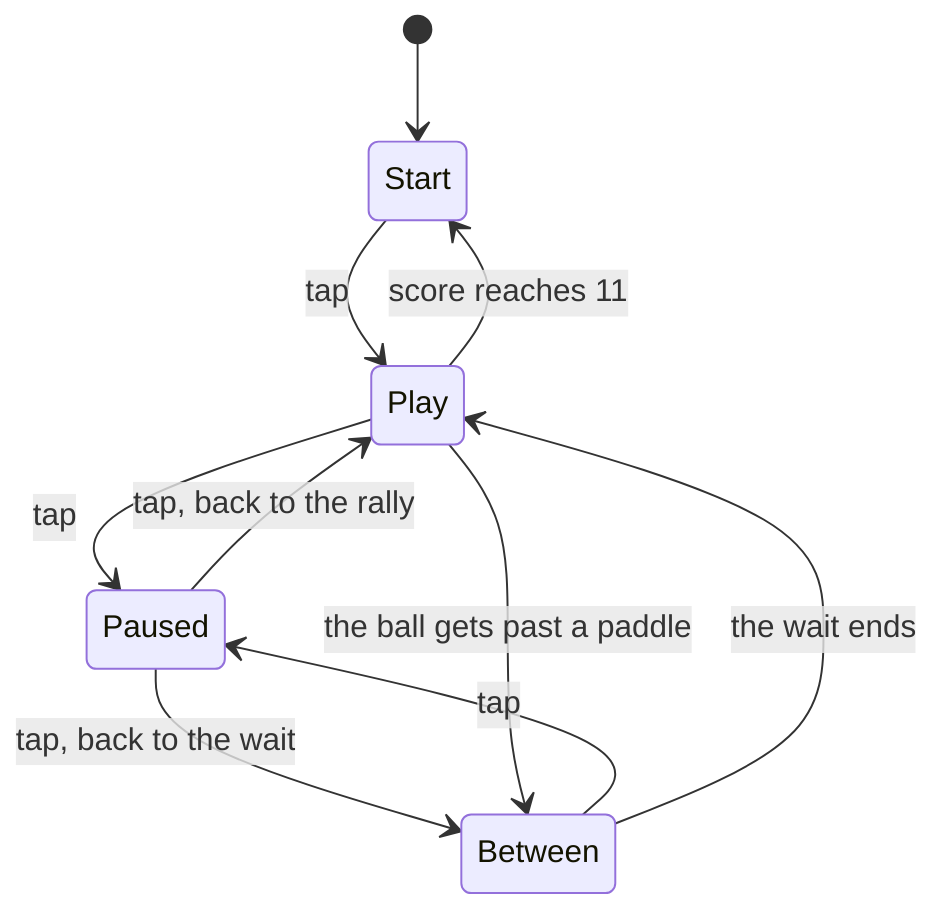

# Pong on a 3.5 inch SPI TFT

Two paddles, one ball, first to 11. The sketch runs on an Arduino Nano clone and a 3.5 inch SPI touchscreen. The glass is portrait: one paddle along the bottom, one along the top. Each player has two buttons on a small breadboard.

The cyan paddle slides along the bottom. The amber paddle slides along the top. The ball starts in the middle and leaves upward or downward. Its speed stays the same for the whole match. Tap the glass to start, tap again to pause, and tap once more to resume. At 11 the start screen comes back and names the winner.

## Project status

The rules of the match are checked on a computer with `make test`: serves, bounces, a pause, and a win. This repo does not include a photo of a finished build.

## System overview

The Nano reads four buttons and the touchscreen. It draws the table on the TFT over SPI. A tap starts the match, pauses it, and resumes it. The buttons only slide the paddles.

The screen's `VCC` comes from 5 V. The backlight comes from the Nano's 3V3 pin. Six signal wires pass through a resistor pair so the screen sees about 3.4 V. D11 and D13 are shared by the screen and the touch chip. D12 comes back from the touch chip with no pair.



The build is split the same way the wires, the boards, and the program are split.

| Page | What it covers |
| --- | --- |
| [Tutorial](docs/TUTORIAL.md) | The build, in order, from power to the first tap |
| [Bench card](docs/WIRING.md) | Every pin on one page |
| [Electrical](docs/ELECTRICAL.md) | 5 V into a 3.3 V panel, the divider, and why D11 and D13 are shared |
| [Hardware](docs/HARDWARE.md) | The three breadboards, and what one row actually is |
| [Software](docs/ARCHITECTURE.md) | The match, the files, and one frame |

## Parts

| Item | Notes | How many |
| --- | --- | --- |
| Arduino Nano clone | ATmega328P. CH340 clones are common. An FTDI port shows up as "USB Serial Port" | 1 |
| 3.5 inch SPI TFT | 480×320 module, used here in portrait. ILI9488 on the common MSP3520 board, which has a touch header | 1 |
| Large breadboard | Holds the Nano and the screen | 1 |
| Mini breadboard | One player each. A third strip if the dividers do not fit on the big board | 2 |
| Tactile buttons | Two per mini breadboard | 4 |
| 470 ohm resistors | In series on the six signal wires | 6 |
| 1 k ohm resistors | From those joints down to ground | 6 |
| Jumper wires | | |
| USB cable | Has to carry data, not charge only | 1 |

Six 220 ohm resistors and six 470 ohm resistors are the other pair that lands at the same voltage. The smaller one goes in the wire from the Nano. The larger one goes to ground. Both sets are drawn in the [tutorial](docs/TUTORIAL.md).

A piezo from D6 to ground is optional. Set `BUZZER_ENABLED` to `1` in `firmware/Pong/config.h` when it is fitted. A CH340 driver on the computer is needed if the Nano's port never appears.

An MSP3521 module has no touch chip. This game starts and pauses from a tap, so it needs the touch header.

## Tools

| Tool | What you use it for |
| --- | --- |
| Computer with the Arduino IDE or PlatformIO | Flashing the sketch |
| USB data cable | The upload, and the serial monitor |
| Optional multimeter | Checking 5 V, 3V3, and ground before the signal wires go on |

## Firmware

Open `firmware/Pong/Pong.ino` in the Arduino IDE. The other files in that folder open as tabs. There are no libraries to install. The upload steps and the serial check are in the [tutorial](docs/TUTORIAL.md).

| Setting | Value |
| --- | --- |
| Board | Arduino Nano |
| Processor | ATmega328P (Old Bootloader) |
| If upload says `stk500_getsync` | Switch Processor to ATmega328P and try again |
| Serial monitor | 115200 baud |

The match has four steps. The start screen waits for a tap. Play moves the ball. Between points the ball sits still for a moment, then serves on its own. Pause freezes whichever of those two you were in.



Buttons do not start or pause the game. They slide a paddle left and right.

[docs/ARCHITECTURE.md](docs/ARCHITECTURE.md) is the software page: every file, one frame from start to finish, and how the picture is drawn without storing it.

### On the computer

The rules in `firmware/Pong/game.cpp` have no hardware code in them:

```bash
make test
```

`make firmware` builds the sketch with [arduino-cli](https://arduino.github.io/arduino-cli/) for the old-bootloader Nano. `make firmware-9486` builds the same sketch with the ILI9486 startup sequence.

PlatformIO, from the repo root:

```bash
pio run -e nano_old -t upload
pio device monitor -b 115200
```

`nano_new` is the same sketch with the newer bootloader.

The ILI9488 build uses 10,734 bytes of flash (34% of 30,720) and 396 bytes of RAM (19% of 2,048). The Nano draws by sending the rectangles that changed. A stored copy of the whole screen does not fit in this chip.

### Layout

```text
firmware/Pong/       sketch: Pong.ino, config.h, game, render, display, input, touch
test/                match tests that run on a computer
tools/make_font.py   letter pictures; rerun it after an edit
docs/TUTORIAL.md     build order
docs/WIRING.md       bench card for every pin
docs/ELECTRICAL.md   voltages and the shared SPI wires
docs/HARDWARE.md     breadboards and one row
docs/ARCHITECTURE.md the match, the files, and one frame
```

`config.h` is the place to change the winning score, the paddle length, and how fast the ball moves.

[CONTRIBUTING.md](CONTRIBUTING.md) lists which file to edit for each kind of change.

## Notes and limitations

- Pause is a tap on the glass. There is no separate pause button.
- The ball does not speed up. That was left out on purpose.
- There is no click unless a piezo is on D6 and `BUZZER_ENABLED` is `1`.
- The Nano has 2048 bytes of RAM. The picture lives on the screen, and the sketch repairs the spots that moved.
- There is no photo of a built board.
- A module with no touch header cannot start or pause this sketch.

## Later

- A photo of the three breadboards once they are built
- A check of the touch pressure numbers on the actual module
- Clicks, if the piezo is fitted

## References

- [docs/TUTORIAL.md](docs/TUTORIAL.md) for the build
- [docs/WIRING.md](docs/WIRING.md) for every pin
- [docs/ELECTRICAL.md](docs/ELECTRICAL.md) for the dividers and the shared wires
- [docs/HARDWARE.md](docs/HARDWARE.md) for the breadboards
- [docs/ARCHITECTURE.md](docs/ARCHITECTURE.md) for the state machine and the drawing path
- ILI9488 and ILI9486 bring-up, and the XPT2046 touch chip on the same header
- The docs follow the split used in [robotictentacle](https://github.com/hronkrobotics/robotictentacle), and the mermaid maps used in [solareyes](https://github.com/hronkrobotics/solareyes)

## License

MIT. See [LICENSE](LICENSE).
