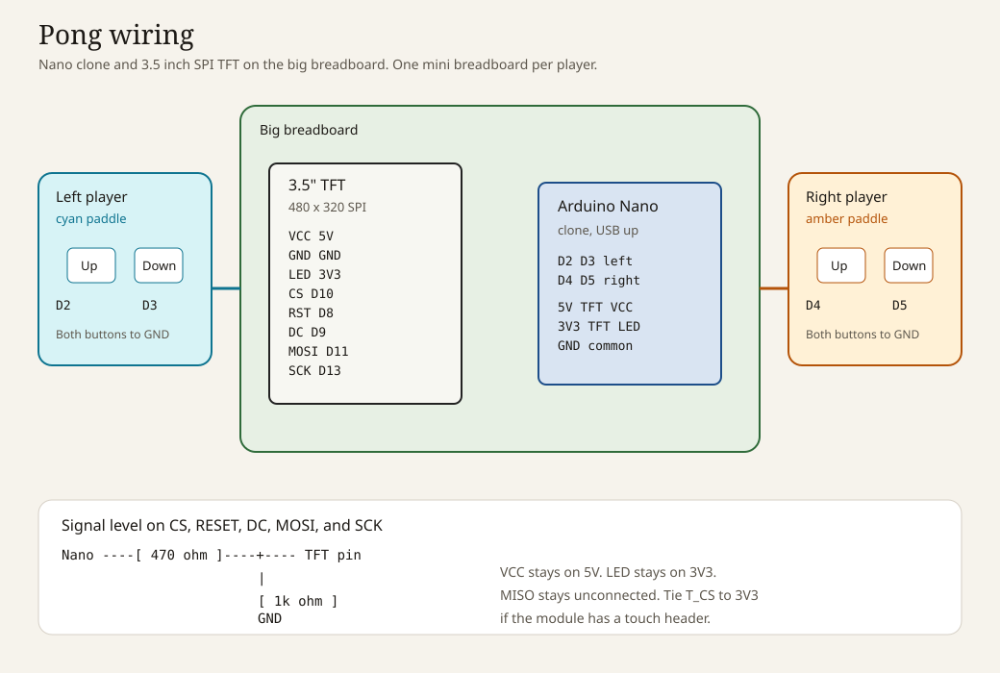

# Pong on a 3.5 inch SPI TFT

Two paddles, one ball, first to 11. The sketch runs on an Arduino Nano clone and a 480×320 SPI TFT, with each player on their own mini breadboard.



The cyan paddle is the left player. The amber paddle is the right player. The ball speeds up every time a paddle hits it, and an off-center hit sends it up or down. After a point the ball sits in the middle, then serves toward the player who missed. The left player receives the opening serve. Any button starts the next match.

## Parts on the bench

- Arduino Nano clone (ATmega328P, usually a CH340 USB chip)
- 3.5 inch SPI TFT, 480×320. The common red module is an ILI9488 (MSP3520 with touch, MSP3521 without)
- One large breadboard for the Nano and the display
- Two mini breadboards, two tactile buttons on each
- Jumper wires
- A USB cable that carries data

Worth having before the board stays powered for a long session:

- Five 470 ohm resistors and five 1 k ohm resistors, for the display's 3.3 V logic pins
- A CH340 driver on the computer, if the Nano's port never appears

A piezo from D6 to GND is optional. Set `BUZZER_ENABLED` to `1` in `firmware/Pong/config.h` when it is fitted.

## Wire it

The full pin list, the button gap, and the resistor divider are on the [bench card](docs/WIRING.md). Short version:

| Nano | Goes to |
| --- | --- |
| 5V | TFT VCC |
| GND | TFT GND, and the ground of both mini breadboards |
| 3V3 | TFT LED, so the backlight stays on |
| D10 | TFT CS |
| D9 | TFT DC / RS |
| D8 | TFT RESET |
| D11 | TFT SDI / MOSI |
| D13 | TFT SCK |
| D2, D3 | Left player's up and down buttons |
| D4, D5 | Right player's up and down buttons |

Leave MISO unconnected. Leave the touch pins unconnected, except `T_CS`: if that pin exists, tie it to 3V3 so the touch chip stays idle.

Each button straddles the center gap of its mini breadboard. One side of the gap goes to the Nano pin, the other side to GND. The sketch turns on the internal pull-ups, so the buttons need no resistors of their own.

The TFT logic pins are 3.3 V, and a Nano pin drives about 5 V. On `CS`, `RESET`, `DC`, `MOSI`, and `SCK`, put a 470 ohm resistor in series and a 1 k ohm resistor from the TFT pin down to GND. `VCC` still comes from 5 V, and `LED` still comes from 3V3. Boards that have a `J1` solder jumper on the back can run with straight wires after that jumper is bridged; the module maker says that path runs warm, so the resistors are the one to leave in place.

## Flash it

Open `firmware/Pong/Pong.ino` in the Arduino IDE. The sketch has no libraries to install.

1. Tools → Board → Arduino Nano
2. Tools → Processor → ATmega328P (Old Bootloader)
3. Tools → Port → the port that shows up when the Nano is plugged in
4. Upload

If `avrdude` reports `stk500_getsync`, switch Processor to ATmega328P and upload again. One of those two entries matches the clone.

Then open the serial monitor at **115200** baud. It prints the pin list, `Init display...`, `Clearing screen...`, and `Ready`. Press each button and confirm the four lines `button: left up`, `left down`, `right up`, and `right down`.

PlatformIO is wired up as well, from the repo root:

```bash
pio run -e nano_old -t upload
pio device monitor -b 115200
```

`nano_new` is the same sketch with the newer bootloader.

## Play

The glass hangs off the big breadboard, so seat the header fully and keep the SCK and MOSI wires short. Prop the panel so the header stays in the holes.

Up on a mini breadboard is the button farther from you, down is the closer one. If a paddle moves the wrong way, swap that player's two pin numbers in `config.h`. If the whole picture is upside down, set `ROTATION` to `3`.

| What you see | What to change in `config.h` |
| --- | --- |
| White backlight, blank picture | Confirm the divider wiring, then try `TFT_DRIVER` `9486` if the silkscreen says ILI9486 |
| Backlight off | LED wire on the Nano's 3V3 pin |
| Red and blue swapped | `TFT_USE_BGR` |
| Colors look like a negative | `TFT_INVERT` |
| Picture mirrored | `TFT_MIRROR` |
| Speckles or a flickering image | Shorter SCK and MOSI wires, and `SPI_HZ` at `2000000` |

## On the computer

Ball physics, scoring, and the serve rules live in `firmware/Pong/game.cpp` and can be tested with no hardware:

```bash
make test
```

`make firmware` builds the sketch with [arduino-cli](https://arduino.github.io/arduino-cli/) for the old-bootloader Nano. The binary is about 9.5 KB, around a third of the 30 KB the bootloader leaves free, and about 340 bytes of RAM out of 2048. The Nano draws by sending pixels as the ball and paddles move. A stored copy of the whole screen does not fit in this chip, and the sketch keeps the picture on the panel itself.

## Layout

```
firmware/Pong/     sketch: Pong.ino plus the game, the panel, and the buttons
test/              physics tests
tools/make_font.py letter pictures; rerun it after an edit
docs/WIRING.md     bench card
```

`config.h` is the place to change the winning score, the paddle size, and how fast the ball gets.

## Collaboration

This project is meant to be built on with AyanRahman. The GitHub account name is `AyanRahman` (Ayan Rahman, no space). After the repository is on GitHub, add that account under Settings → Collaborators so both of you can push. [CONTRIBUTING.md](CONTRIBUTING.md) lists which file owns which part of the game.

## License

MIT. See [LICENSE](LICENSE).
