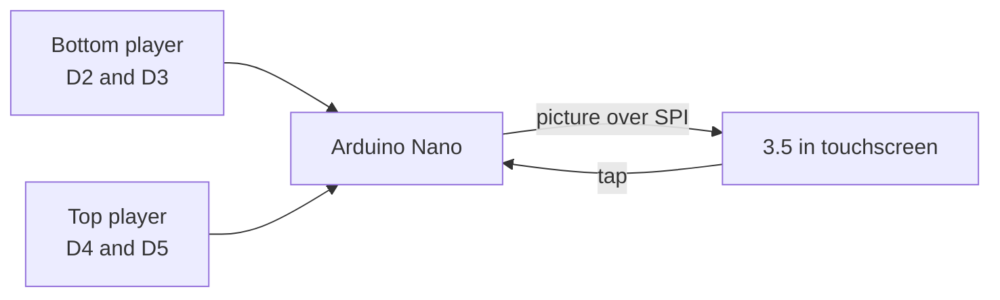
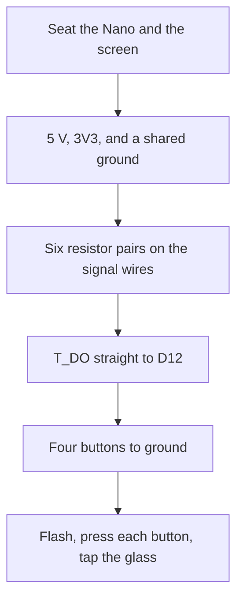
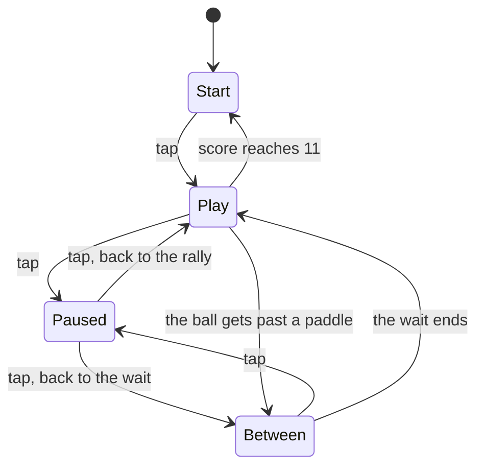

# Pong on a 3.5 inch SPI TFT

Two paddles, one ball, first to 11. The sketch runs on an Arduino Nano clone and a 3.5 inch SPI touchscreen. The glass is portrait: one paddle along the bottom, one along the top. Each player has two buttons on a small breadboard.


The cyan paddle slides along the bottom. The amber paddle slides along the top. The ball starts in the middle and leaves upward or downward. Its speed stays the same for the whole match. Tap the glass to start, tap again to pause, and tap once more to resume. At 11 the start screen comes back and names the winner.

## Project status

The rules of the match are checked on a computer with `make test`: serves, bounces, a pause, and a win. The wiring picture is a schematic of the three breadboards. This repo does not include a photo of a finished build.

## System overview

The Nano reads four buttons and the touchscreen. It draws the table on the TFT over SPI. A tap starts the match, pauses it, and resumes it. The buttons only slide the paddles.



The screen's `VCC` comes from 5 V. The backlight comes from the Nano's 3V3 pin. Signal wires from the Nano pass through two resistors so the screen sees about 3.3 V. [docs/ARCHITECTURE.md](docs/ARCHITECTURE.md) follows the same machine from a tap to a pixel.

## Parts

| Item | Notes | How many |
| --- | --- | --- |
| Arduino Nano clone | ATmega328P, usually a CH340 USB chip | 1 |
| 3.5 inch SPI TFT | 480×320 module, used here in portrait. ILI9488 on the common MSP3520 board, which has a touch header | 1 |
| Large breadboard | Holds the Nano and the screen | 1 |
| Mini breadboard | One player each | 2 |
| Tactile buttons | Two per mini breadboard | 4 |
| 470 ohm resistors | In series on the 5 V signal wires | 6 |
| 1 k ohm resistors | From those wires down to ground | 6 |
| Jumper wires | | |
| USB cable | Has to carry data, not charge only | 1 |

A piezo from D6 to ground is optional. Set `BUZZER_ENABLED` to `1` in `firmware/Pong/config.h` when it is fitted. A CH340 driver on the computer is needed if the Nano's port never appears.

An MSP3521 module has no touch chip. This game starts and pauses from a tap, so it needs the touch header.

## Tools

| Tool | What you use it for |
| --- | --- |
| Computer with the Arduino IDE or PlatformIO | Flashing the sketch |
| USB data cable | The upload, and the serial monitor |
| Optional multimeter | Checking 5 V, 3V3, and ground before the screen is wired |

## Board layout

Three breadboards, one shared ground.

**Big breadboard.** The Nano and the screen sit here. The glass hangs off the edge, so seat the header all the way and keep the SCK and MOSI wires short.

**Left mini breadboard, cyan.** The bottom player. Two buttons, left and right.

**Right mini breadboard, amber.** The top player. Two buttons, left and right.

Left and right are as that player looks at their own paddle.

## Wiring

The picture at the top of this page is the whole board in one view. Read it by the numbers.

1. **Middle.** The big breadboard. The white card is the screen, the blue card is the Nano. Each line is one wire: pin on the part, then the Nano pin it goes to.
2. **Left.** Bottom player. Left button to D2, right button to D3. The other side of each button goes to ground.
3. **Right.** Top player. Left button to D4, right button to D5. The other side goes to ground.
4. **Bottom.** Two resistors that drop a 5 V Nano pin to about 3.3 V. Build that pair for `CS`, `RESET`, `DC`, `MOSI`, `SCK`, and `T_CS`.

`T_DO` is already 3.3 V. It goes straight to D12, with no resistors. Leave `T_IRQ` empty. Leave the screen's own `SDO` pin empty. Do not tie `T_CS` to 3V3. The sketch has to drive that pin, or a tap never arrives.

The `MOSI` resistor pair feeds both the screen and `T_DIN`. The `SCK` pair feeds both the screen and `T_CLK`. `VCC` still comes from 5 V. The backlight (`LED`) still comes from 3V3.

Every pin, the button gap, and the resistor pair are written out on the [bench card](docs/WIRING.md).

| Nano | Goes to |
| --- | --- |
| 5V | TFT VCC |
| GND | TFT GND, and the ground of both mini breadboards |
| 3V3 | TFT LED |
| D10 | TFT CS |
| D9 | TFT DC / RS |
| D8 | TFT RESET |
| D11 | TFT SDI / MOSI, and touch `T_DIN` |
| D13 | TFT SCK, and touch `T_CLK` |
| D12 | Touch `T_DO` |
| D7 | Touch `T_CS` |
| D2, D3 | Bottom player's left and right |
| D4, D5 | Top player's left and right |

Some of these red boards have a solder jumper marked `J1` on the back. Bridging `J1` and powering `VCC` from 5 V lets the signal wires go straight across. The module maker says that path runs warm and ages the panel. The resistors are the wiring to leave in place.

## Build it

1. Seat the Nano and the screen header on the big breadboard. The glass hangs off the side. Prop it so the header stays in the holes.
2. Run 5 V to the screen `VCC`, 3V3 to `LED`, and ground to the screen and to both small breadboards.
3. Build the six resistor pairs. Connect `CS`, `RESET`, `DC`, `MOSI`, `SCK`, and `T_CS` through them. From the `MOSI` joint, also jump to `T_DIN`. From the `SCK` joint, also jump to `T_CLK`.
4. Run `T_DO` straight to D12. Leave `T_IRQ` and the screen's `SDO` empty.
5. Seat each button across the center gap of its mini breadboard. One side of the gap goes to the Nano pin. The other side goes to ground.
6. Flash the sketch, open the serial monitor, press each button, then tap the glass.



## Firmware

Open `firmware/Pong/Pong.ino` in the Arduino IDE. The other files in that folder open as tabs. There are no libraries to install.

| Setting | Value |
| --- | --- |
| Board | Arduino Nano |
| Processor | ATmega328P (Old Bootloader) |
| If upload says `stk500_getsync` | Switch Processor to ATmega328P and try again |
| Serial monitor | 115200 baud |

The monitor prints the pin list, then `Ready. Tap the screen to start.` Press each button and look for `button: bottom left`, `bottom right`, `top left`, and `top right`. A tap prints `touch: tap`.

The match has four steps. The start screen waits for a tap. Play moves the ball. Between points the ball sits still for a moment, then serves on its own. Pause freezes whichever of those two you were in.



Buttons do not start or pause the game. They slide a paddle left and right. If a paddle moves the wrong way, swap that player's two pin numbers in `config.h`. If the whole picture is upside down, set `ROTATION` to `2`.

The ball leaves the middle toward the top or the bottom. An off-center hit angles it sideways. The speed does not increase. At 11 the start screen returns with `BOTTOM WINS` or `TOP WINS`, and a tap starts a new match at 0–0.

[docs/ARCHITECTURE.md](docs/ARCHITECTURE.md) is the longer version: every file, one frame from start to finish, and how the picture is drawn without storing it.

| What you see | What to change in `config.h` |
| --- | --- |
| White backlight, blank picture | Confirm the resistor pairs, then try `TFT_DRIVER` `9486` if the silkscreen says ILI9486 |
| Backlight off | `LED` on the Nano's 3V3 pin |
| Red and blue swapped | `TFT_USE_BGR` |
| Colors look like a negative | `TFT_INVERT` |
| Picture mirrored | `TFT_MIRROR` |
| Speckles or a flickering image | Shorter SCK and MOSI wires, and `SPI_HZ` at `2000000` |

### On the computer

The rules in `firmware/Pong/game.cpp` have no hardware code in them:

```bash
make test
```

`make firmware` builds the sketch with [arduino-cli](https://arduino.github.io/arduino-cli/) for the old-bootloader Nano. `make firmware-9486` builds the same sketch with the ILI9486 startup sequence.

PlatformIO, from the repo root:

```bash
pio run -e nano_old -t upload
pio device monitor -b 115200
```

`nano_new` is the same sketch with the newer bootloader.

The ILI9488 build uses 10,734 bytes of flash (34% of 30,720) and 396 bytes of RAM (19% of 2,048). The Nano draws by sending the rectangles that changed. A stored copy of the whole screen does not fit in this chip.

### Layout

```text
firmware/Pong/       sketch: Pong.ino, config.h, game, render, display, input, touch
test/                match tests that run on a computer
tools/make_font.py   letter pictures; rerun it after an edit
docs/WIRING.md       bench card for every pin
docs/ARCHITECTURE.md the match, the files, and one frame
```

`config.h` is the place to change the winning score, the paddle length, and how fast the ball moves.

[CONTRIBUTING.md](CONTRIBUTING.md) lists which file to edit for each kind of change.

## Notes and limitations

- Pause is a tap on the glass. There is no separate pause button.
- The ball does not speed up. That was left out on purpose.
- There is no click unless a piezo is on D6 and `BUZZER_ENABLED` is `1`.
- The Nano has 2048 bytes of RAM. The picture lives on the screen, and the sketch repairs the spots that moved.
- The wiring picture is a schematic. It is not a photo of a built board.
- A module with no touch header cannot start or pause this sketch.

## Later

- A photo of the three breadboards once they are built
- A check of the touch pressure numbers on the actual module
- Clicks, if the piezo is fitted

## References

- [docs/ARCHITECTURE.md](docs/ARCHITECTURE.md) for the state machine and the drawing path
- [docs/WIRING.md](docs/WIRING.md) for every pin
- ILI9488 and ILI9486 bring-up, and the XPT2046 touch chip on the same header
- The docs in this repo follow the same outline as [solareyes](https://github.com/hronkrobotics/solareyes)

## 5 V and the screen

The screen's signal pins are 3.3 V. A Nano pin drives about 5 V. Use the resistor pair on `CS`, `RESET`, `DC`, `MOSI`, `SCK`, and `T_CS`. `VCC` may come from 5 V. Power the backlight from the 3V3 pin, not from 5 V.

## License

MIT. See [LICENSE](LICENSE).
