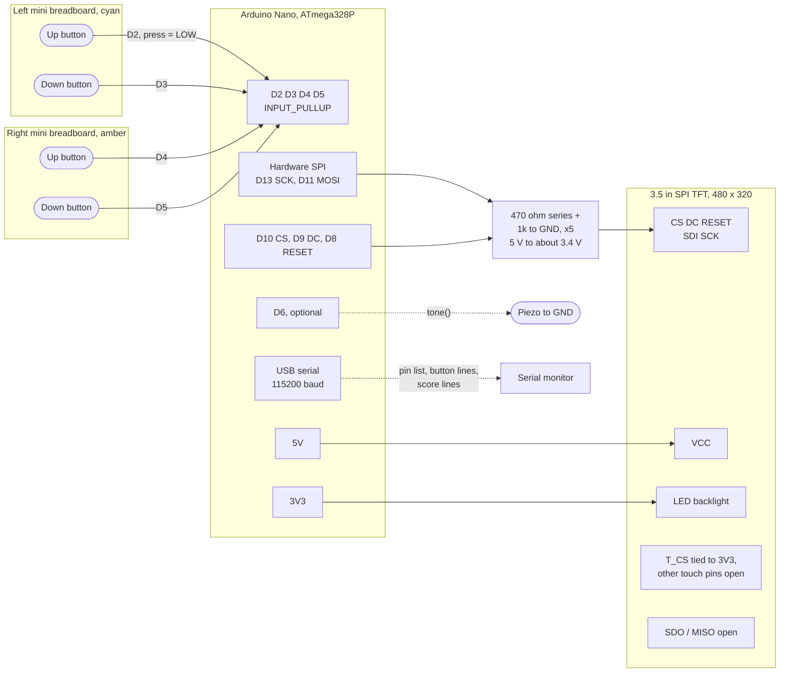
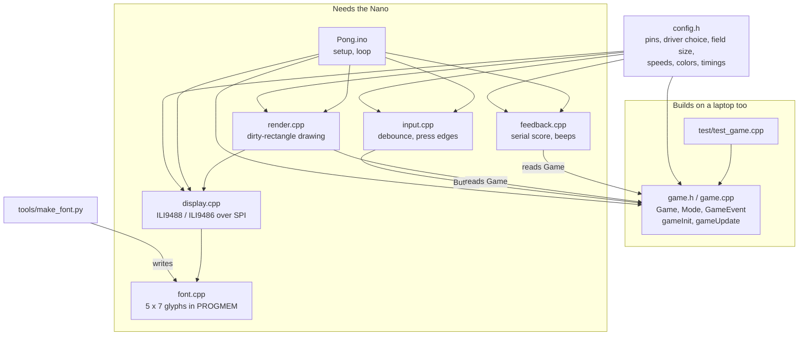
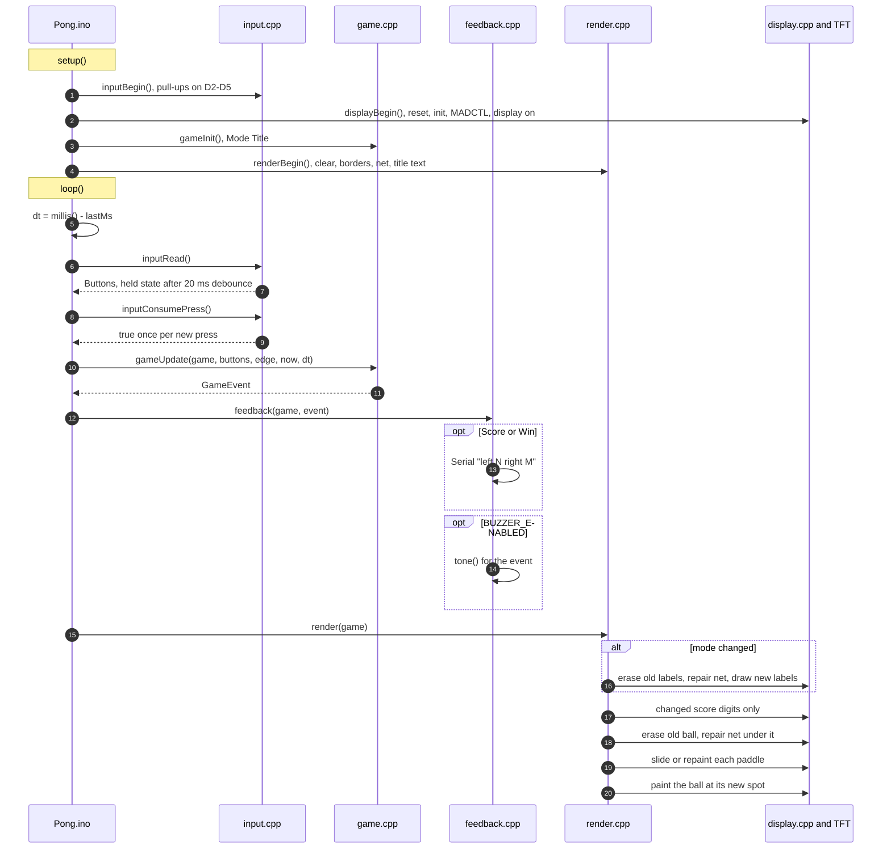
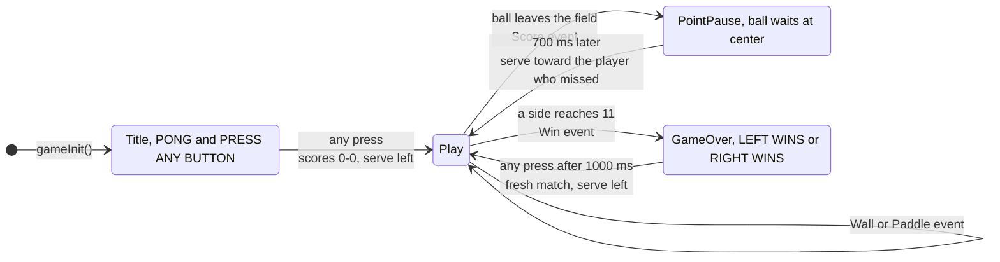
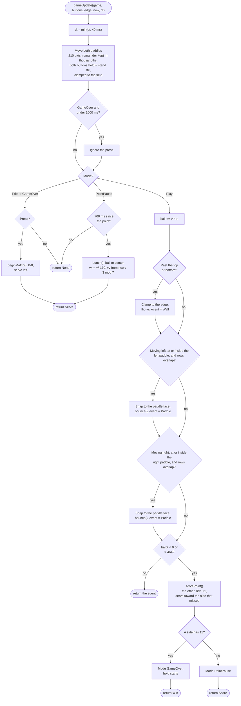
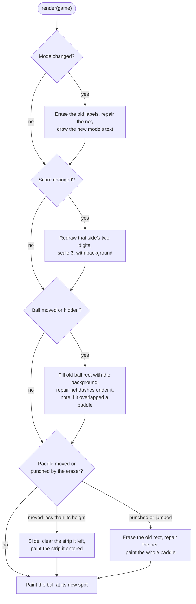
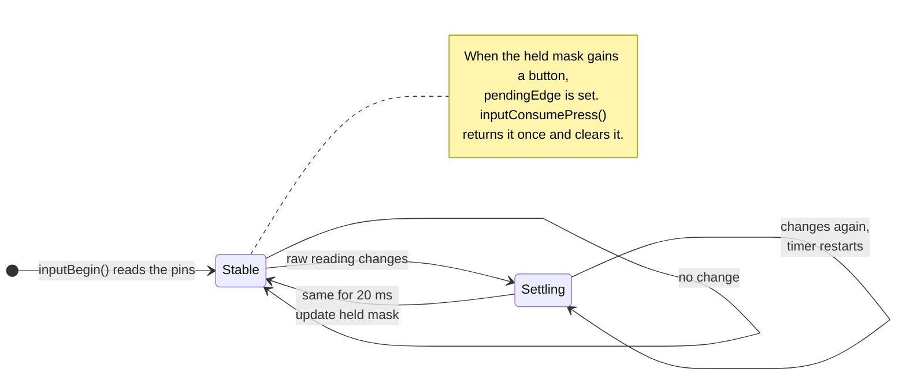

# How the game works

This page follows one button press from the mini breadboard to pixels on the glass. Pins and the resistor dividers are on the [bench card](WIRING.md). Which file to edit is in [CONTRIBUTING.md](../CONTRIBUTING.md).

## The bench

All grounds are shared: the Nano, the TFT, and both mini breadboards.

## Firmware files

`game.cpp` holds every rule and touches no hardware. `make test` compiles it on a laptop with `test/test_game.cpp`.

## One pass of loop()

`loop()` has no frame timer. Each pass measures the real time since the last one, and `gameUpdate()` caps it at `MAX_FRAME_MS` (40 ms), so a slow redraw can't throw the ball through a paddle.

## Game modes

Paddles move in every mode, so players can line up during the title screen and the pauses.

## Inside gameUpdate()

All positions are fixed point: `ballX` and `ballY` are pixels times `FP_ONE` (256). Speeds are pixels per second.

`bounce()` adds `SPEED_BUMP` (16) to the horizontal speed, keeps it between 160 and 320 px/s, and adds `ENGLISH` (5) px/s of vertical speed for every pixel the ball's center sits away from the paddle's center, capped at 280 px/s.

## Drawing without a frame buffer

A full 480 x 320 picture at 3 bytes a pixel is 460,800 bytes. The Nano has 2,048 bytes of RAM. `render.cpp` remembers where the ball and paddles were and repaints only what changed.

Every fill goes through `displayFillRect()`: set the column and row window (`0x2A`, `0x2B`), send `0x2C`, then stream 3 bytes per pixel. Typical SPI traffic at 4 MHz (2 µs per byte, before loop overhead):

| Drawing | Bytes | Time on the bus |
| --- | ---: | ---: |
| Ball erase plus repaint, 16 x 16 twice | 1,536 | about 3 ms |
| Paddle slide by 4 px, two 14 x 4 strips | 336 | under 1 ms |
| One side's score, two digits at scale 3 | 2,079 | about 4 ms |
| Whole screen at boot | 460,800 | about 0.9 s |

## Buttons

With `DEBUG_BUTTONS` on, each new press also prints `button: left up` and the like, which is how the README's wiring check works.
