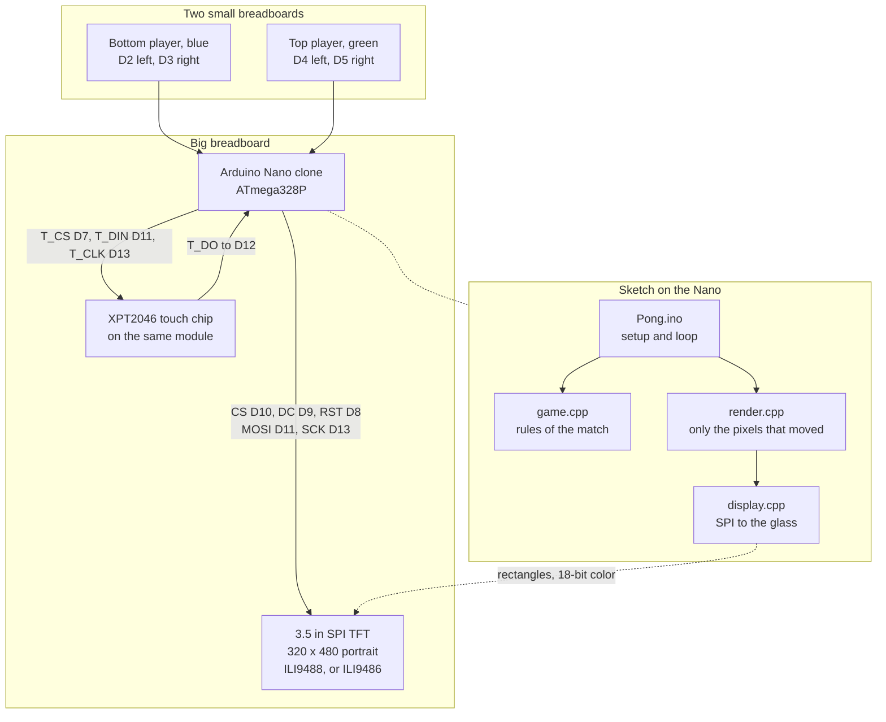
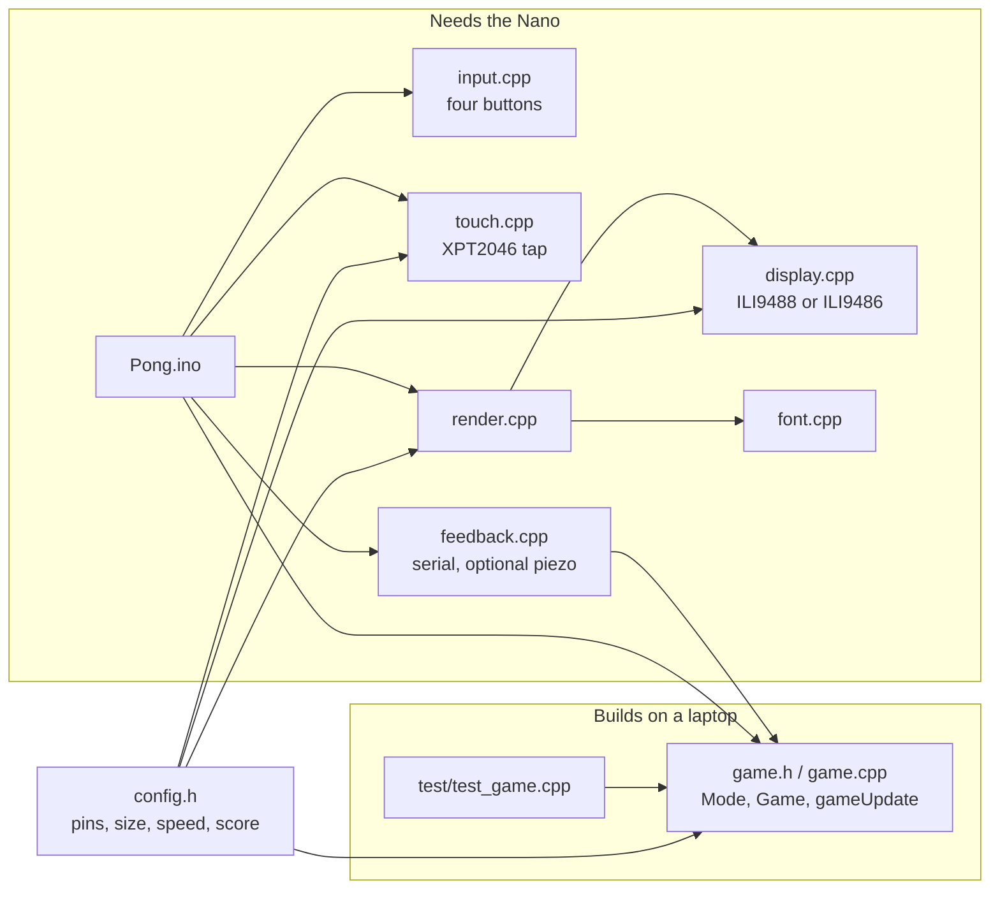
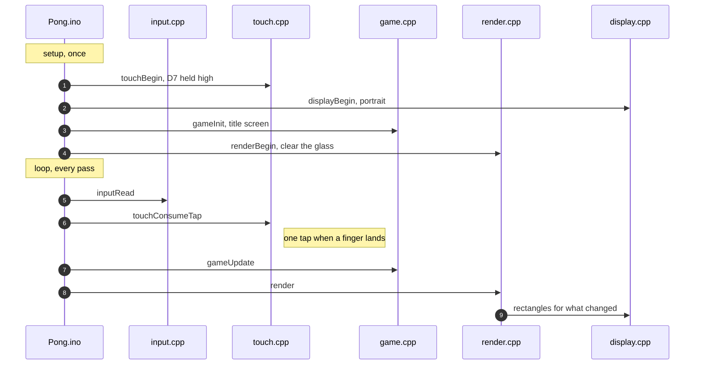
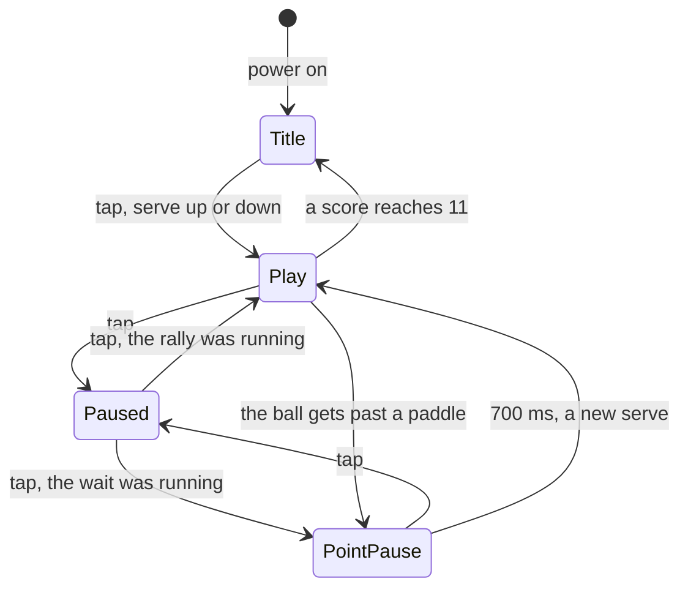
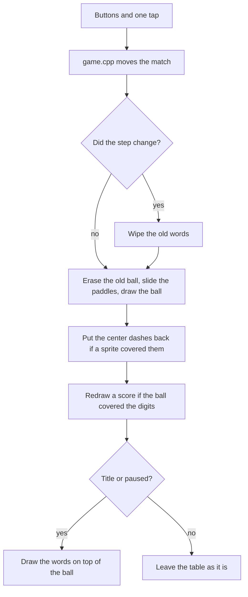

# How this Pong game works

This page is the software. It follows one match from a finger on the glass to a pixel on the screen. Voltages are in [ELECTRICAL.md](ELECTRICAL.md). The boards are in [HARDWARE.md](HARDWARE.md). The pin table is the [bench card](WIRING.md). The build order is the [tutorial](TUTORIAL.md). Which file to edit is in [CONTRIBUTING.md](../CONTRIBUTING.md).

The diagrams are maps. A box is a part or a file. An arrow means a wire, or "this step comes next." Each diagram has a short reading of the same idea in sentences, so you can skip the picture and still follow the program.

## The whole table

Three breadboards. The big one holds the Nano and the screen. Each small one holds one player's buttons. The sketch is the files in `firmware/Pong/`.

Start at the Nano in the middle. Buttons come in from the two players. The Nano sends the picture out on the SPI wires, and the touch chip sends a tap back on D12. The four files under the Nano are the program: the loop, the rules, the drawing, and the screen driver.

Power is not on this map. The screen's `VCC` comes from 5 V, the backlight comes from the Nano's 3V3 pin, and every board shares ground. Signal wires that leave a Nano pin go through the resistor pair in [ELECTRICAL.md](ELECTRICAL.md), because those pins are 5 V and the screen wants 3.3 V.

## The sketch, file by file

`game.cpp` is only the rules. It does not know about pins, SPI, or the screen. That is why `make test` can play a whole match on a laptop. Anything that touches a pin lives in the other files.

| File | What it owns |
| --- | --- |
| `Pong.ino` | Starts the board, then each frame reads buttons, reads a tap, updates the match, and draws |
| `config.h` | Pin numbers, colors, paddle size, ball speed, points to win |
| `game.cpp` | The four screens of a match, the ball, and the score |
| `input.cpp` | Four buttons, with a short wait so a noisy press counts once |
| `touch.cpp` | One tap when a finger lands. Holding the finger down does not count again |
| `render.cpp` | Repaints the paddles, the ball, the scores, and the words |
| `display.cpp` | Wakes the ILI9488 or ILI9486 and sends rectangles over SPI |
| `feedback.cpp` | The serial score line, and a click if a piezo is fitted |
| `font.cpp` | The letter shapes for the words on the glass |

The laptop box is the part you can change and check with no board on the desk. The Nano box is everything that needs the chip.

## From power-on to one frame

Once, at boot:

1. The serial port opens at 115200.
2. The four button pins are set as inputs with pull-ups, so a press reads low and the buttons need no resistors of their own.
3. Touch chip-select (D7) is driven high, so the touch chip stays quiet while the screen is set up.
4. The screen wakes in portrait, 320 by 480.
5. The match starts on the title screen. The ball sits in the middle and does not move.
6. The glass is cleared and the title is drawn. The serial line says to tap.

Every pass of `loop()` after that:

1. Measure how long the last pass took. A stall longer than 40 ms is treated as 40 ms, so the ball cannot jump through a paddle.
2. Read the four buttons.
3. Read the touch chip. A tap is the moment a finger lands, and only if the last tap was at least 300 ms ago.
4. Hand those to `gameUpdate`.
5. Print a score, a pause, or a win.
6. Repaint what moved.

## The match

A player sees three things: the start screen, the game, and the word `PAUSED`. There is a fourth step inside the program, between points, when the ball sits still for 700 ms and then serves itself. A tap during that wait pauses it. The wait does not run out while the game is paused, and it does not get skipped.

The names in the code are `Title`, `Play`, `PointPause`, and `Paused`.

| What you see | Name in the code | What is moving |
| --- | --- | --- |
| `PONG` and `TAP TO START` | `Title` | Nothing. After a win, the winner's name is on this screen too |
| The ball in flight | `Play` | Ball and both paddles |
| Ball sitting still after a point | `PointPause` | Paddles only. After 700 ms the ball serves again |
| `PAUSED` and `TAP TO RESUME` | `Paused` | Nothing. A tap returns to the step you left |

Buttons never change the step. They only slide a paddle, and they do that during `Play` and during `PointPause`. On the title screen and while paused, the paddles stay where they are.

The ball:

- It starts in the middle of the gap between the paddles.
- The opening serve, and every serve after a point, picks up or down from the clock. It is not always the same player who receives.
- A small sideways speed is added so the serve is not a dead straight line.
- The vertical speed stays at `SERVE_SPEED` for the whole match. Paddle hits do not speed the ball up.
- Where the ball meets the paddle sets the sideways speed. The middle sends it straight. Toward an end, it angles off, up to `MAX_VX`.
- The left and right edges of the glass bounce it back. The top and bottom are the goals. Past the top paddle, the bottom player scores. Past the bottom paddle, the top player scores.
- At 11 the match returns to the title screen, the winner is named, and the score stays on screen until the next tap. That tap starts a new match at 0–0.

## From the rules to the glass

The Nano has 2048 bytes of RAM. A stored copy of a 320×480 picture does not fit, and this screen wants three bytes per pixel. The sketch keeps the picture on the glass and only repaints the rectangles that changed: a sliver of a paddle, the ball's old spot, the ball's new spot, a score the ball passed over, and the words when the screen changes.

1. If the step changed, wipe the old words. If those words covered the ball, the ball is drawn again.
2. Erase the ball where it was. Slide each paddle by erasing the trailing edge and drawing the leading edge. Draw the ball in its new spot. If any of that covered the dashed line, put the dashes back.
3. If the ball covered a score, draw those two digits again so the number is whole.
4. On the title screen and the pause screen, draw the words after the sprites so a ball underneath does not punch a hole in the letters.

The dashed line is horizontal, across the middle of the gap. The bottom paddle is blue. The top paddle is green. The bottom player's score sits just above the bottom paddle. The top player's score sits just under the top paddle.

## What the Nano can hold

The old-bootloader Nano has 30,720 bytes of flash and 2,048 bytes of RAM. The current ILI9488 build uses 10,734 bytes of flash (34%) and 396 bytes of RAM (19%). The ILI9486 build uses 10,616 bytes of flash and 386 bytes of RAM. There is no full-screen buffer: `display.cpp` sends each rectangle as 18-bit color over SPI and then throws it away.

The touch read borrows the same SPI wires. Display chip-select stays high, touch chip-select goes low, the chip is asked for a pressure sample, then touch chip-select goes high again before the next rectangle. The touch clock is 2 MHz. The screen clock is 4 MHz.
