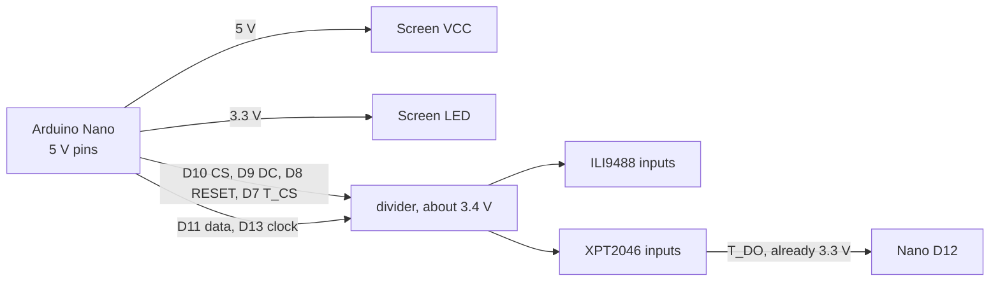
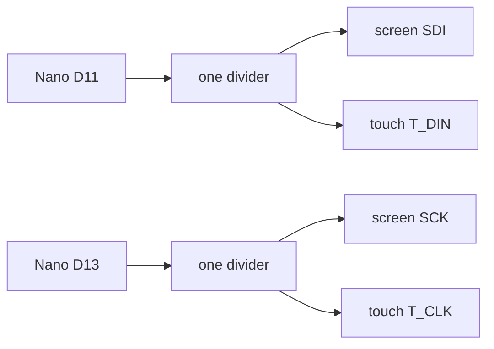

# Electrical

The Nano's signal pins are 5 V. The screen and the touch chip read those pins as 3.3 V logic. Power wiring, the six dividers, and the shared SPI wires are below. The pin table for the bench is [WIRING.md](WIRING.md).



## Power

`VCC` on the module can take 5 V. Use the Nano's 5V pin. `LED` is the backlight. Use the Nano's 3V3 pin. Every board shares GND.

Those three wires have no resistors.

## Why the divider exists

A Nano pin high is about 5 V. The screen's logic inputs and the touch chip's inputs are built for about 3.3 V. Five volts into those pins wears the panel out.

Each divider is two resistors:

```
Nano pin ----[ 470 ohm ]----+---- screen pin
                            |
                         [ 1k ohm ]
                            |
                           GND
```

The joint voltage is `5 V × 1000 / (470 + 1000)`, about 3.4 V. The screen reads that as a high. The same shape with the parts swapped the other way is wrong: 470 ohm down to ground and 1k in the wire would sit near 1.6 V, and the screen would read it as a low.

Any pair with the ground resistor about twice the series resistor lands near 3.3 V.

| In the wire from the Nano | Down to ground | Joint |
| --- | --- | --- |
| 470 ohm | 1k ohm | 3.4 V |
| 220 ohm | 470 ohm | 3.4 V |
| 1k ohm | 2k ohm or 2.2k ohm | 3.3 V to 3.4 V |

The series resistor wants to stay between about 220 ohm and 1k ohm. The sketch clocks the screen at 4 MHz, and a much larger series resistor rounds off the edges on a breadboard. Six signals, each sourcing a few milliamps while high, is inside what a Nano pin can drive.

Build one pair for each of `CS`, `RESET`, `DC`, `SDI`, `SCK`, and `T_CS`. That is six series resistors and six ground resistors.

`T_DO` is the other direction. The touch chip drives it at 3.3 V into the Nano, so it goes straight to D12. The Nano reads 3.3 V as a high.

Some red modules have a solder jumper marked `J1` on the back. Closing `J1` and feeding `VCC` from 5 V lets the signal wires go straight across. The module maker says that path runs warm and ages the panel. Leave `J1` open and keep the dividers.

## Shared data and clock

The screen and the touch chip are two SPI listeners on one master. SPI uses one data wire, one clock wire, and a select wire per chip. A chip pays attention only while its select pin is low.

| Nano | Listeners | Select that wakes that chip |
| --- | --- | --- |
| D11, data out | screen `SDI` / `MOSI`, and touch `T_DIN` | screen `CS` on D10, touch `T_CS` on D7 |
| D13, clock | screen `SCK`, and touch `T_CLK` | same two selects |



Both of those screen pins are inputs. The Nano is the only chip driving the wire, so the two inputs can share it. While the sketch draws, `CS` is low and `T_CS` is high, and the touch chip ignores the bits. While the sketch reads a tap, `T_CS` is low and `CS` is high, and the screen ignores the bits.

`T_DO` is an output from the touch chip, so it has its own wire to D12. The screen's `SDO` is also an output. The sketch never reads it. Two outputs tied to one Nano pin would fight, so `SDO` stays empty. `T_IRQ` stays empty. The sketch polls the touch chip over SPI instead of waiting for an interrupt.

`T_CS` has to be driven by D7. Tying it to 3V3 holds the touch chip silent forever, and a tap never arrives.
