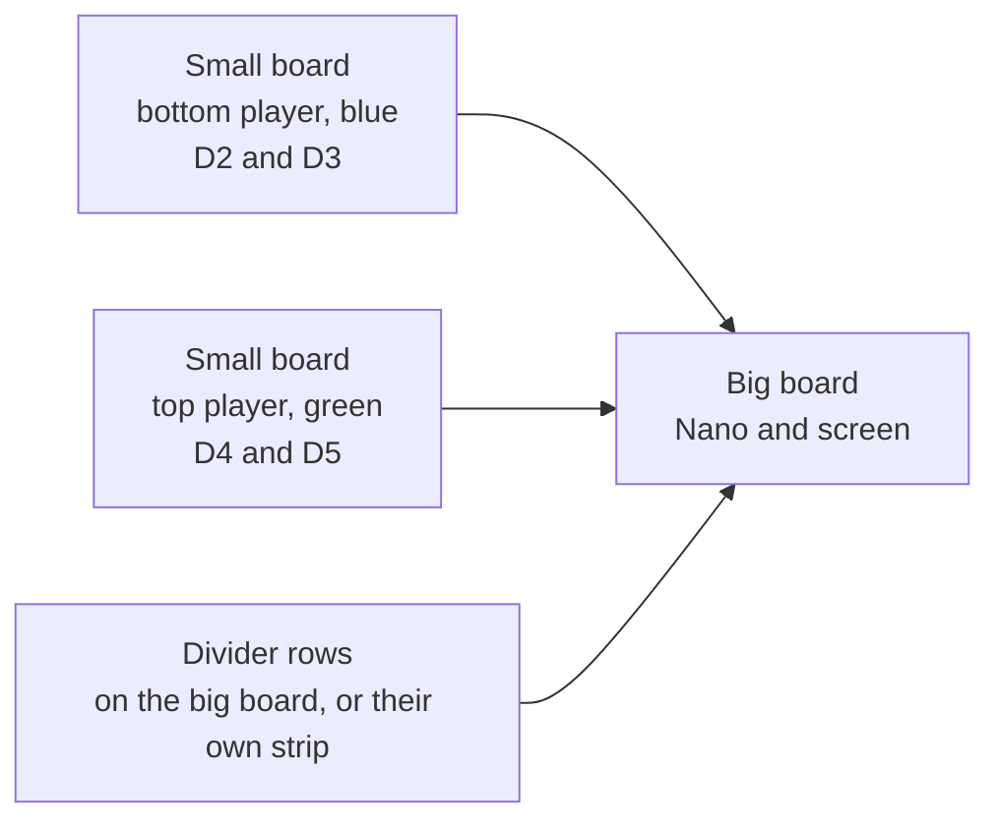

# Hardware

Three breadboards and one shared ground. This page is how the parts sit. The voltages are in [ELECTRICAL.md](ELECTRICAL.md). The wire list is in [WIRING.md](WIRING.md).



## Big breadboard

The Nano and the screen header sit here. The glass hangs off the edge. Seat the header all the way, and prop the glass so the header stays in the holes.

D11 and D13 are the fast wires. Keep those jumpers short.

## One breadboard row

A row number is split by the center slot. The five holes on the left are tied to each other. The five holes on the right are tied to each other. The slot keeps the two halves apart until a part joins them.

```
row 1

left half              slot           right half
[ Nano wire ]----[ 220 or 470 ohm ]----[ screen wire ]
                                         |
                                    [ 470 ohm or 1k ]
                                         |
                                    ground rail
```

The series resistor is the part that crosses the slot. The Nano wire plugs into the left half. The screen wire plugs into the right half. The ground resistor also starts in the right half, and its other leg goes in the ground rail. The ground rail is the long strip on the edge of the board. It is not the other half of the row.

The holes straight across the slot from a Nano pin are the pin on the other side of the Nano, when the Nano is seated across the slot. Those holes belong to that other pin.

If a resistor leg cannot reach from the Nano's row to the screen's row, put the six dividers on a spare strip or a third mini breadboard. Jumper wires cover the distance. The resistors stay on that strip. One ground wire runs from that strip's ground rail back to the Nano's GND.

## Button boards

Each small breadboard is one player. Two buttons. Seat each button so it straddles the center gap of that board. The legs on one side of the gap are already connected inside the switch. One side of the gap goes to the Nano pin. The other side goes to ground.

Left and right are as that player looks at their own paddle. The bottom player is the blue paddle. The top player is the green paddle.

Run one ground wire from each small board back to the ground rail on the big board.
