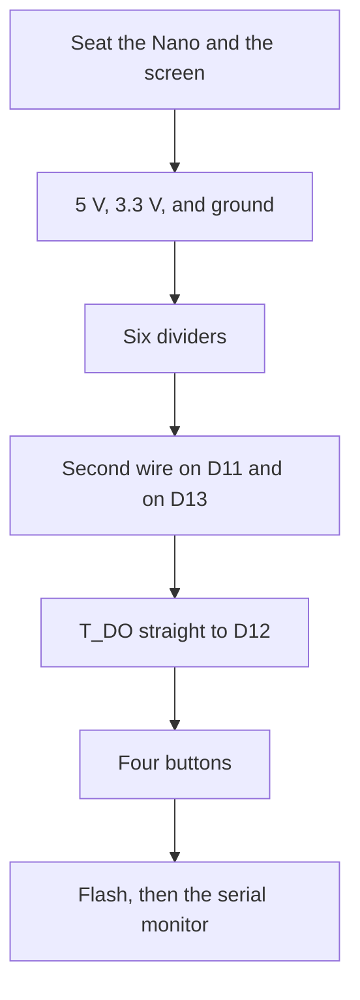

# Build

Wire power first, then the six dividers, then the buttons, then flash. This page is the order. The pin table is [WIRING.md](WIRING.md). Stop after the power step and check 5 V, 3.3 V, and ground with a meter if you have one, before the signal wires go on.

| The question | The page |
| --- | --- |
| Why a voltage, a divider, or a shared wire | [ELECTRICAL.md](ELECTRICAL.md) |
| Where the boards sit, and what one breadboard row is | [HARDWARE.md](HARDWARE.md) |
| Every pin on one page | [WIRING.md](WIRING.md) |
| What the program does after the flash | [ARCHITECTURE.md](ARCHITECTURE.md) |



## 1. Seat the parts

Put the Nano and the screen header on the big breadboard. The glass hangs off the side. Prop it so the pins stay in the holes.

The two small breadboards are the players. Bottom player on the left, blue paddle, D2 and D3. Top player on the right, green paddle, D4 and D5.

If the big board has no free rows left for resistors, keep a spare strip for the six dividers. The resistors live on that strip. Jumper wires go out to the Nano and the screen.

Where each board sits is in [HARDWARE.md](HARDWARE.md).

## 2. Power

No resistors.

| Nano | Screen |
| --- | --- |
| 5V | VCC |
| 3V3 | LED |
| GND | GND |

Run a ground wire from each small breadboard to this same GND.

Why `VCC` is 5 V and `LED` is 3.3 V is in [ELECTRICAL.md](ELECTRICAL.md).

## 3. One divider

Build this shape once and look at it before copying it five more times.

```
Nano wire ----[ 470 ohm ]----+---- screen wire
                             |
                          [ 1k ohm ]
                             |
                        ground rail
```

The 470 ohm is the resistor in the wire from the Nano. Yellow, violet, brown. The 1k is the resistor from the joint down to the ground rail. Brown, black, red.

If the parts in your hand are 220 ohm and 470 ohm, the 220 ohm goes in the wire and the 470 ohm goes to ground. Red, red, brown in the wire. Yellow, violet, brown down to ground. That joint is also about 3.4 V. The 470 ohm does not move to the Nano side to match a drawing that shows 470 ohm there with a 1k to ground.

On a breadboard, the series resistor crosses the center slot of one row. The Nano wire is in the left half of that row. The screen wire and one leg of the ground resistor are in the right half. The other leg of the ground resistor is in the ground rail.

Why the pair has to land near 3.4 V, and which other resistor values do that, is in [ELECTRICAL.md](ELECTRICAL.md). Which holes share a connection is in [HARDWARE.md](HARDWARE.md).

## 4. The four simple signals

Same shape, one row each.

| Nano | Screen |
| --- | --- |
| D10 | CS |
| D8 | RESET |
| D9 | DC / RS |
| D7 | T_CS |

## 5. The two shared signals

D11 is one divider, then two wires from the joint.

```
D11 ----[ series ]----+---- SDI / MOSI
                      |
                      +---- T_DIN
                      |
                   [ to ground ]
                      |
                    ground
```

D13 is the same, with the clock pins.

```
D13 ----[ series ]----+---- SCK
                      |
                      +---- T_CLK
                      |
                   [ to ground ]
                      |
                    ground
```

There are still only six dividers. SDI and T_DIN share one. SCK and T_CLK share one.

Why those two wires are shared, and why that does not make the chips talk over each other, is in [ELECTRICAL.md](ELECTRICAL.md).

## 6. The straight wire, and the empty pins

`T_DO` goes straight to D12. No resistors.

Leave `T_IRQ` empty. Leave `SDO` empty. Do not tie `T_CS` to 3V3.

Why `T_DO` is a straight wire, and why `SDO` stays empty, is in [ELECTRICAL.md](ELECTRICAL.md).

## 7. Buttons

Seat each button across the center gap of its small breadboard. One side of the gap goes to the Nano pin. The other side goes to ground. No resistors.

| Player | Left | Right |
| --- | --- | --- |
| Bottom, blue | D2 | D3 |
| Top, green | D4 | D5 |

Left and right are as that player looks at their own paddle.

How a button sits across the gap is in [HARDWARE.md](HARDWARE.md). The same four pins are on the [bench card](WIRING.md).

## 8. Flash

Open `firmware/Pong/Pong.ino` in the Arduino IDE. The other files in that folder open as tabs. There are no libraries to install.

| Setting | Value |
| --- | --- |
| Board | Arduino Nano |
| Processor | ATmega328P (Old Bootloader) |
| If upload says `stk500_getsync` | Switch Processor to ATmega328P and try again |
| Serial monitor | 115200 baud |

A port named "USB Serial Port" is an FTDI chip. Those Nanos usually need the second processor choice, ATmega328P, at 115200. CH340 clones usually take the old bootloader.

The cable has to carry data. A charge-only cable never shows a port.

From the repo root, with PlatformIO:

```bash
pio run -e nano_old -t upload
pio device monitor -b 115200
```

`nano_new` is the same sketch with the newer bootloader.

What the sketch does from power-on through one frame is in [ARCHITECTURE.md](ARCHITECTURE.md).

## 9. Check

The monitor prints the pin list, then `Ready. Tap the screen to start.`

Press each button. Look for `button: bottom left`, `bottom right`, `top left`, and `top right`. Tap the glass. The monitor prints `touch: tap`, and the ball leaves the middle.

| What you see | What to check |
| --- | --- |
| White backlight, blank picture | The six dividers, then `TFT_DRIVER` `9486` in `config.h` if the silkscreen says ILI9486 |
| Backlight off | `LED` on the Nano's 3V3 pin |
| Red and blue swapped | `TFT_USE_BGR` in `config.h` |
| Colors look like a negative | `TFT_INVERT` |
| Picture mirrored | `TFT_MIRROR` |
| Picture upside down | `ROTATION` set to `2` |
| A paddle moves the wrong way | Swap that player's two pin numbers in `config.h` |
| Speckles or a flickering image | Shorter D11 and D13 wires, and `SPI_HZ` at `2000000` |

The match itself, the winner screen, and which file owns each part are in [ARCHITECTURE.md](ARCHITECTURE.md).
